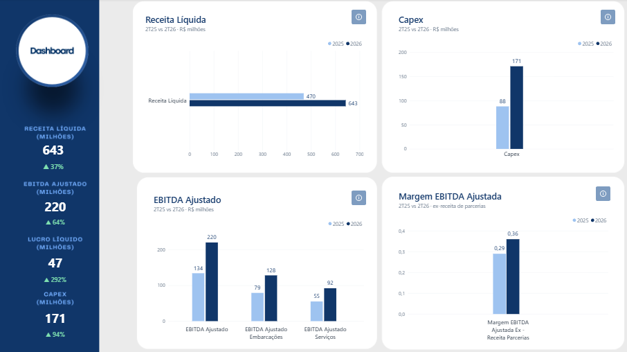
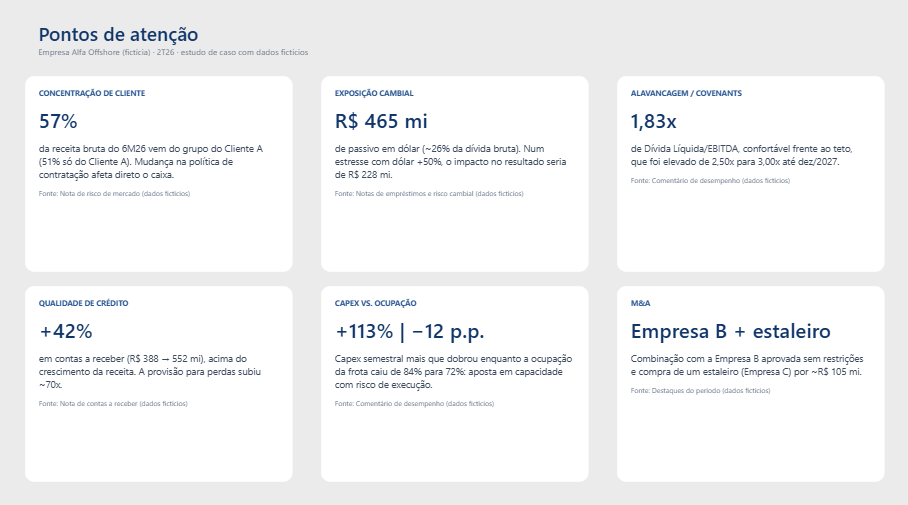

# Case Empresa Alfa — Análise de Resultado do 2T26

> ⚠️ **Dados 100% fictícios.** Este é um estudo de caso criado para fins de portfólio e aprendizado. A estrutura foi inspirada em um ITR (Informações Trimestrais) real, mas **nenhum número corresponde a uma empresa existente**.

Análise de resultado trimestral de uma empresa fictícia de serviços offshore (*Empresa Alfa Offshore S.A.*), com o caminho completo: dados brutos em Excel → modelagem e checagem dos indicadores → dashboard no Power BI → leitura de riscos para um relatório de investimento.


---

## 🎯 Perguntas que a análise responde

1. A empresa cresceu de forma saudável no trimestre (receita, EBITDA, margem, lucro)?
2. O crescimento depende de receitas não recorrentes (parcerias)?
3. Como está a alavancagem frente aos covenants da dívida?
4. Quais riscos não aparecem nos números de destaque, mas importam para o *valuation*?

## 📊 Principais números (2T26 vs. 2T25)

| Indicador | 2T26 | 2T25 | Variação |
|---|---:|---:|---:|
| Receita Líquida (R$ mi) | 643 | 470 | +37% |
| Receita Líquida ex-Parcerias (R$ mi) | 612 | 468 | +31% |
| EBITDA Ajustado (R$ mi) | 220 | 134 | +64% |
| Margem EBITDA Ajustada ex-Parcerias | 36% | 29% | +7 p.p. |
| Lucro Líquido (R$ mi) | 47 | 12 | +292% |
| Capex (R$ mi) | 171 | 88 | +94% |
| Dívida Líquida Bancária / EBITDA LTM | 1,83x | 2,21x | −0,38x |
| Taxa de Ocupação da Frota | 78% | 85% | −7 p.p. |

## 🔎 Pontos de atenção levantados

- **Concentração de cliente:** 51% da receita bruta vem de um único cliente (57% somando o grupo econômico).
- **Exposição cambial:** cerca de R$ 465 mi de passivos atrelados ao dólar (cerca de 26% da dívida bruta). Num cenário de estresse com o dólar 50% mais alto, o impacto no resultado é de −R$ 228 mi.
- **Covenants:** o teto de Dívida Líquida/EBITDA subiu de 2,50x para 3,00x. A alavancagem atual (1,83x) está confortável.
- **Qualidade de crédito:** a provisão para perdas cresceu cerca de 70x e o contas a receber subiu 42%.
- **Capex vs. capacidade:** o capex semestral mais que dobrou enquanto a ocupação da frota caiu 12 p.p.
- **M&A e contingências:** há uma combinação de negócios aprovada, a aquisição de um estaleiro e uma ação judicial ganha contra o principal cliente.

## 🖥️ Dashboard

| Informações do Trimestre | Pontos de Atenção |
|---|---|
|  |  |

O relatório tem 3 páginas (Capa, Informações do Trimestre e Pontos de Atenção), navegação por bookmarks e tema visual próprio.

🎬 **Vídeo de demonstração (43 s):** [empresa-alfa-2t26.mp4](empresa-alfa-2t26.mp4)

## 📁 Estrutura do repositório

```
├── empresa-alfa-2t26.pbix          # Dashboard Power BI
├── empresa-alfa-2t26-dados.xlsx    # Base de dados e análise
├── empresa-alfa-2t26.mp4           # Vídeo de demonstração
├── imagens/                        # Prints do dashboard
└── README.md
```

### Abas da planilha

| Aba | Conteúdo |
|---|---|
| `Info.Trimestrais` | Destaques financeiros e operacionais (2T26, 2T25, 6M26, 6M25) com variações reportadas **e recalculadas por fórmula**, como ponto de checagem |
| `Dados_PowerBI` | Mesma base em formato longo (tidy), pronta para o modelo do Power BI |
| `Pontos_de_Atencao` | Riscos qualitativos e quantitativos com leitura analítica |
| `Receita`, `EBITDA`, `Margem EBITDA`, `DL per EBITDA`, `Capex`, `Lucro` | Recortes por indicador usados nos visuais |

Na aba `Info.Trimestrais`, os valores em **azul** são dados de entrada e os em **preto** são fórmulas recalculadas a partir dos valores absolutos.

## 🛠️ Ferramentas

- **Excel:** estruturação da base, fórmulas de checagem e formato tidy
- **Power BI:** modelagem, medidas DAX de variação (Δ%), bookmarks e tema customizado

## ▶️ Como abrir

1. Baixe o repositório (**Code → Download ZIP**) ou clone:
   ```bash
   git clone https://github.com/gabrielanjos-crypto/case-empresa-alfa-analise-resultado.git
   ```
2. Abra o `empresa-alfa-2t26.pbix` no [Power BI Desktop](https://www.microsoft.com/power-platform/products/power-bi/desktop) (gratuito).
3. Se o Power BI pedir a fonte de dados, aponte para o arquivo `empresa-alfa-2t26-dados.xlsx` da mesma pasta.

## 👤 Autor

**Gabriel Brum dos Anjos**, Legal Ops e análise de dados (Power BI, SQL, Python)
[LinkedIn](https://www.linkedin.com/in/gabriel-brum-dos-anjos/)

---

*Os dados deste repositório são fictícios e não devem ser usados para decisões de investimento.*
